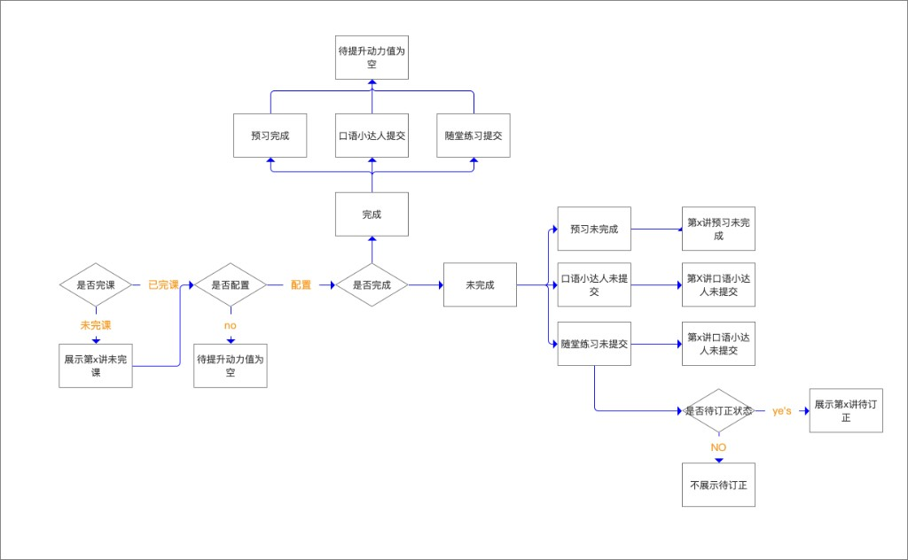

# 万象补漏 PRD

班主任为一个学生创建提升任务，确认视频切片和相似题后，用企微私聊把话术、高光和专项练卡片发给家长。历史任务的完成明细另文，本文不写。

页面两步：创建任务 → 配置发送内容 → 发送。发送成功后，历史任务新增一条记录。

---

## 0. AI 解读

打开页面即展示。用下面的提示词读取 JSON，生成四段文案。待巩固和未学习必须分开写，不得编造 JSON 里没有的讲次、知识点和任务。

### 提示词

```text
你是班主任工作台的学情解读助手。根据输入 JSON，为这一名学生写四段 AI 学情解读，供老师创建提升任务前阅读。

输出要求：
1. 只输出四段正文，不要标题、序号和解释。
2. 第一段：{学生姓名}{学科}{课程类型}学期已开课 {已开课讲次数} 讲。动力值未补齐时，写明当前更需要先处理 JSON 里实际存在的缺口，例如完课、交作业、订正。动力值已补齐时，不写这句。
3. 第二段以「动力值待补足：」开头。按讲次合并该讲的缺口，讲次之间用分号。某一讲没有缺口就不写。全部没有缺口时，写「动力值已补齐。」
4. 第三段以「知识点待点亮：」开头。待巩固写成「{知识点}是已上课后待巩固的内容」；未学习写成「{知识点}是已上课但还没学习」。两类都有时用分号衔接，并加上「这两类要分开看。」只有一类时不写这句话。某一类为空则不写该类。
5. 第四段以「近 1 个月共 {任务数} 个提升任务：」开头。已完成写「{任务名}已完成」；有进度但未完成写「{任务名}完成 {进度}%」；待完成写「{下发时间}下发的{任务名}尚未开始」。多个任务用逗号连接。没有任务时写「近 1 个月没有提升任务。」`{进度}` 取该任务完成度，口径见第 8 节，四舍五入为整数。
6. 使用学生姓名、学科和讲次序号，不输出字段名。
```

### JSON

字段与上面四段一一对应。下面是页面示例「晓明」的输入。

```json
{
  "studentName": "晓明",
  "subject": "数学",
  "courseType": "课本",
  "openedLessonCount": 3,
  "powerReady": false,
  "powerGaps": [
    { "lessonNo": 1, "items": ["未完课", "作业未交"] },
    { "lessonNo": 2, "items": ["作业未交"] },
    { "lessonNo": 3, "items": ["错题待订正"] }
  ],
  "knowledge": {
    "toConsolidate": ["勾股定理", "方差", "三角函数"],
    "notLearned": ["大数"]
  },
  "recentTasks": [
    { "name": "三角函数专项巩固", "status": "已完成" },
    { "name": "勾股定理强化练习", "status": "完成中", "progress": 40 },
    { "name": "方差知识点补漏", "status": "待完成", "createdAt": "10月14日 16:00" }
  ]
}
```

按这份 JSON 生成的结果：

> 晓明数学课本学期已开课 3 讲。动力值还没补齐，当前更需要先补完课、交作业和订正。  
> 动力值待补足：第 1 讲未完课、作业未交；第 2 讲作业未交；第 3 讲错题待订正。  
> 知识点待点亮：勾股定理、方差、三角函数是已上课后待巩固的内容；大数是已上课但还没学习，这两类要分开看。  
> 近 1 个月共 3 个提升任务：三角函数专项巩固已完成，勾股定理强化练习完成 40%，10 月 14 日 16:00 下发的方差知识点补漏任务尚未开始。

## 1. 任务名称

- 必填，最多 50 字。去掉首尾空格后不能为空。
- 默认：`{创建日期}{学生姓名}的提升计划`。
- 创建日期格式为 `M月D日`，不含年份。
- 示例：8 月 19 日打开页面，学生晓明，默认名称为 `8月19日晓明的提升计划`。
- 点击「生成补漏任务并配置发送内容」时校验。同一学生已有提升任务中，名称去重：与已有名称相同则不能创建，提示「任务名称已存在，请修改后再创建」。比较时忽略首尾空格。

## 2. 截止时间

- 默认取打开页面的日期 + 7 天。
- 示例：8 月 19 日打开，默认截止 8 月 26 日。
- 提交时必填，且晚于当前时间。

## 3. 讲次

- 多选。
- 默认勾选 1 讲：在「该讲完课时间 − 1 天」之前已经上过的讲次里，取最近一讲（只取常规课标准场次的第几讲）。
- 原型里的默认第 3 讲是 mock，不代表这条规则。
- 目标和资源随已选讲次联动。取消某讲后，该讲已选的知识星、动力值，以及知识点属于该讲的视频、相似题，一并移除。

## 4. 任务目标

选填。候选项只来自当前选中的讲次。

### 知识星待点亮

悬停提示原文：

> 说明：展示学生已观看课程，但尚未掌握、需要巩固的知识点；未看课的知识点不会在此处展示。

展示规则：列出选中讲次中，知识星状态为 **未学习** 或 **待巩固** 的知识点名称。

### 动力值待补足

按下面流程判断每一讲要不要展示、展示哪一项。页面按类型分层，层内再列讲次。没有命中的层不出现。



**判断顺序**

1. 是否完课。
   - 未完课：展示「第 x 讲未完课」，然后同样进入是否配置，继续判断预习、口语小达人、随堂练习。
   - 已完课：不展示「未完课」，直接进入是否配置。
2. 是否配置预习、口语小达人、随堂练习。
   - 未配置：这一讲待提升动力值为空，不展示。
   - 已配置：逐项判断是否完成。
3. 已完成的项不展示。预习完成、口语小达人已提交、随堂练习已提交，都回到待提升动力值为空。三项都完成时，这一讲不展示任何动力值缺口。
4. 未完成的项按层展示：
   - 预习未完成 → 「第 x 讲预习未完成」
   - 口语小达人未提交 → 「第 x 讲口语小达人未提交」
   - 随堂练习未提交 → 「第 x 讲随堂练习未提交」
5. 随堂练习再判断是否待订正。
   - 是：展示「第 x 讲待订正」。
   - 否：不展示待订正。

**分层展示**

同一讲的不同缺口分到不同层。多讲选中时，同一层下面按讲次排列。

- 未完课
  - 第 1 讲未完课
- 预习未完成
  - 第 2 讲预习未完成
- 口语小达人未提交
  - 第 2 讲口语小达人未提交
- 随堂练习未提交
  - 第 3 讲随堂练习未提交
- 待订正
  - 第 3 讲待订正

## 5. 已关联内容

已关联区域默认展示当前知识点对应的视频切片和相似题。新增时可以在课树上查找其他知识点，再取该知识点下的视频或相似题。

### 视频切片

取数链路：

1. 搭建资源管理平台。课堂视频按知识点标记并切分后，存入资源管理平台。
2. 资源管理平台把知识点和视频切片 ID 传入 C 端伴学的知识点管理视频。
3. 工作台通过这条链路接入，按知识点和视频切片 ID 取到切片并展示。

标题展示已选个数，如「已关联视频切片 · 2」。

每条外显：封面、切片名称、知识点名称、匹配度、时长、来源。

| 操作 | 结果 |
| --- | --- |
| 播放 | 在当前列表展开预览 |
| 替换 | 打开替换弹窗，只换当前这一条 |
| 删除 | 从本页去掉该视频 |

替换弹窗：知识点筛选只显示这条视频的知识点名称，不能增删。弹窗内可以预览播放。

新增弹窗：知识点筛选不预填已勾选知识星，可以增加或去掉知识点名称。选择和预览方式与替换相同。

同一任务内同一视频不能关联两次。

### 相似题

取数链路：从 C 端伴学后台获取知识点和相似题 ID，展示在本区域。默认展示当前知识点对应的相似题；也可以在课树上查找知识点，再取该知识点下的相似题。

标题展示已选个数。列表展示题干、知识点名称、匹配度。操作与视频相同：替换、删除。视频才有列表播放。

新增、替换弹窗的知识点筛选规则与视频相同：替换锁定原知识点，新增不预填、可增减知识点。

弹窗展示题干和选项，并带题目标签：自动判卷、客观、难度、题型、网校审校。点击题干展开答案、解析、标注。标注示例：`【内容云-数学】三角函数`。

## 6. 配置发送内容

点击「生成补漏任务并配置发送内容」后打开弹窗。

- 发送方式为企微私聊，支持选择私聊模板。
- 模板正文可删改。变量点击插入，可删除。
- 左侧改文案，右侧预览即时替换成该生的真实学情。未识别的变量保留原文。
- 正式开发按真实值取数。原型右侧的答题数、正确率等是 mock，不能当成取值规则。

变量：

学生姓名、身份、讲次序号、课堂称号、应学习知识点数、应学习知识点、答题数、已掌握知识点数、已掌握知识点、待巩固知识点数、待巩固知识点、待巩固做题正确率、未学习知识点数、未学习知识点、动力值待改善项。

以下变量都取上一步「配置专项提升任务」中勾选的讲次。

- 讲次序号：取勾选的讲次内容。
- 课堂称号：取课堂侧该讲次的称号。勾选多个讲次时，取最后一个讲次的称号。
- 应学习知识点：取勾选讲次对应大纲目录关联的知识点数。个数写入「应学习知识点数」，名称明细写入「应学习知识点」。
- 答题数：取勾选讲次对应知识点下，学生已作答的题数之和，包括课中互动和随堂练习。
- 已掌握知识点：取勾选讲次对应大纲目录关联的已掌握知识点明细。「已掌握知识点数」为该明细的个数。
- 待巩固知识点、未学习知识点：口径与已掌握知识点相同，分别取待巩固、未学习的知识点明细。对应的知识点数为明细个数。
- 待巩固做题正确率：在勾选讲次的待巩固知识点中，学生做对的题数比上这些知识点里学生已作答的题数。
- 动力值待改善项：取本次提升任务里，勾选讲次中已配置的动力值待补足明细。

默认文案中的动力值一句为：`动力值待补足项有：第一讲未完课、第二讲未作业订正。` 不再使用「动力值未达三星数」「动力值未达三星条件」。

高光时刻：课中连麦、拍照上墙，可多选。勾选后，按所选讲次，每个分类取时间从近到远的最近 3 张图发给用户。不足 3 张则有几张发几张。字段旁悬停释义：「会基于选中的讲次默认取各分类时间顺序最近的三张图片发给用户。」

专项练：附带 H5 链接，以微信卡片发送。

- 封面：图片占位图标。
- 标题：任务名称。示例：`8月19日小明提升计划`。
- 副标题：`针对勾股定理三角函数第一讲未完课做学情补足方案。点击快速完成`。

未选发送方式或正文为空时，不能发送。

## 7. 发送之后

发送成功后，该任务写入历史任务列表，新增一条记录。初始状态为待完成。原型不追加这条历史记录。

历史任务的页面字段和回看交互另文。任务状态的判断口径在本文第 8 节。

## 8. 任务状态

状态有三种：待完成、完成中、已完成。先判断已完成，未达到再判断完成中，两类都不满足则为待完成。

### 已完成

按任务里实际包含的内容判断。

- 知识点提升：关联的视频都看完，关联的题目都做对。
- 动力值提升：对应动力值任务完成。

同一任务两类都有时，两类都达到才算已完成。

### 完成中

未达到已完成，且满足以下任意一项：

1. 知识点视频：学生点进视频，且观看时长大于等于 5 秒。
2. 知识点题目：有提交。提交了但未做对，仍是完成中。
3. 动力值提升：有跳转行为，或有按钮点击。

只点开视频、观看不足 5 秒，不计入完成中。

### 待完成

不满足已完成，也不满足完成中的任一项。

### 完成度

完成度 = 已配置且状态为已完成的内容数 / 已配置的内容数。

已配置内容逐项计数，每一项计 1，作为分母：

- 每个动力值待补足项
- 每个视频切片
- 每道相似题

分子只统计这些项里状态为已完成的数量。视频看完为已完成，题目做对为已完成，动力值待补足项在该项任务完成时为已完成。题目已提交但未做对，不计入分子。

示例：任务配置了「第一讲未完课」「第二讲未订正作业」，针对勾股定理配置了 2 个视频切片和 2 道题，针对三角函数配置了 2 个视频切片和 1 道题。分母 = 1 + 1 + 2 + 2 + 2 + 1 = 9。分子是这 9 项里状态为已完成的数量。

百分比四舍五入为整数。AI 解读第四段的「完成 {进度}%」，以及 AI 解读右侧完成详情里的学生完成度，都用这个口径。

同一任务里每一项动力值提升都单独计数。页面「三角函数专项巩固」配置了 1 个视频、2 道题、2 项动力值（第三讲完课、第三讲订正错题），五项都已完成，完成度 = 5 / 5。完成详情按「视频 + 题目 + 动力值」展示这个分子。早于本任务的课程历史记录不计入。

页面示例「勾股定理强化练习」配置了 2 项动力值（第一讲完课、第二讲作业提交，都未完成）、1 个视频（已看完）、2 道题（答对 1 道），完成度 = 2 / 5 = 40%。
